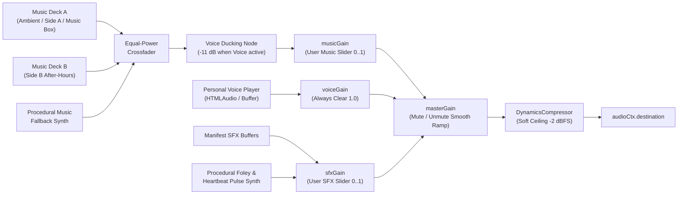

# 07 — AUDIO, MICROPHONE & HAPTICS ENGINEERING SPECIFICATION

**Document ID:** `DOC-07`  
**Covers Requirements:** `REQ-AUD-01` through `REQ-AUD-04`, `REQ-STR-00`, `REQ-STR-04`, `REQ-STR-07`, `REQ-STR-08A`, `REQ-STR-08B`, `REQ-STR-08C`

---

## 1. Web Audio Engine Architecture (`src/engine/audio/AudioEngine.ts`)

### 1.1 Browser Autoplay & Gesture-Gate Compliance (`REQ-AUD-01`)
- **Zero Pre-Gesture Audio:** `AudioContext` is instantiated **lazily** inside the synchronous `click` / `keydown` event handler of `ENTER MY UNIVERSE` (or the `SoundControlPill` unmute button if Uci entered muted and enables sound later).
- **Tab Visibility Discipline:** Listens to `document.addEventListener('visibilitychange', ...)`: smoothly ramps `masterGain` to `0.0001` over `180ms` and calls `audioCtx.suspend()` when `document.hidden === true`; resumes gently when Uci returns to the tab (only if `!isMuted`).

### 1.2 Signal Routing Graph & Independent Mixing Buses


- **Independent Controls (`SoundControlPill.tsx`):**
  1. **One-Click Master Mute/Unmute** (`M` keyboard shortcut when not typing in Act VII's wish `<textarea>`).
  2. **Expandable Popover Mixer:** Independent **Background Music** slider (`0%–100%`, default `70%`) and **Sound Effects & Interactions** slider (`0%–100%`, default `85%`), plus **Voice Captions** toggle (`On` by default).
- **Automatic Voice Ducking:** Whenever any personal voice recording (`01-opening-voice`, `02-memory-*`, `06-whisper-*`, `07-birthday-letter-voice`) enters playback, `Duck` smoothly attenuates `MusicBus` to `0.28` (`-11 dB`) over `350ms` and restores it `500ms` after voice playback pauses or ends.

---

## 2. Act-by-Act Sound Design & Procedural Fallback Specification (`REQ-AUD-02`)

**Anti-Irritation Rule:** `ProceduralAudio.ts` must **never** run continuous raw sine/sawtooth bass drones or static white-noise loops that become fatiguing on laptop speakers or headphones. Every procedural sound uses finite ADSR envelopes, soft low-pass filtering (`< 2.4 kHz`), and spacious silence between musical phrases.

| Stage | Primary Audio Cue (Manifest File) | Self-Contained Procedural Fallback (`ProceduralAudio.ts`) | Interactive Modulation |
| :--- | :--- | :--- | :--- |
| **00 → 01 Entry** | `/media/audio/music/00-cosmic-ambient-loop.mp3` | Sparse, airy `Fmaj9` glass-bell shimmer notes (`triangle` + `sine` harmonics with `3.5s` decay & stereo delay every `6s`) | Entry gesture triggers warm bloom chord |
| **01. Sky Bridge** | `/media/audio/sfx/chime-star-connect.mp3` + `/media/audio/voice/01-opening-voice.mp3` | Rising golden pentatonic harp arpeggio (`C5–E5–G5–B5–D6`) on star snap | Triggers opening voice note (or caption reveal if audio file absent) |
| **02. Memories** | Optional `/media/audio/voice/02-memory-*-voice.mp3` | Soft crystalline bell harmonic on keepsake open | Music ducks automatically if memory voice note plays |
| **03. Mirror** | `/media/audio/sfx/mirror-wipe-soft.mp3` | Subtle band-passed (`900 Hz`, `Q=1.8`) velvet friction whisper gated strictly by active pointer movement speed (`gain = clamp(speed * 0.04, 0, 0.08)`, `0` when cursor stops!) + soft chime on each of the 5 discovered notes | Zero sound when pointer is stationary |
| **04A. Vinyl Side A** | `/media/audio/music/04-vinyl-side-a-daylight.mp3` | `92 BPM` warm major-key electric-piano (`Rhodes`-style FM tine) 4-bar chord progression (`Dbmaj7 – Bbm7 – Gbmaj7 – Ab6`) | Tonearm drop starts playback; rotary vinyl drag modulates `playbackRate` (`0.4x – 1.6x`) + soft scratch bandpass sweep |
| **04A. Vinyl Side B** | `/media/audio/music/04-vinyl-side-b-afterhours.mp3` | `68 BPM` velvet minor-9th late-night progression (`F#m9 – C#m7 – Dmaj7 – C#7alt`) with warm envelope sub-pulse | `800ms` equal-power crossfade + low-pass filter sweep on Side A ↔ Side B toggle |
| **04B. Stars** | Procedural star-harmonic chimes | Each of the 8 stars plays a unique note from a romantic Lydian scale (`F4` through `G5`); `8/8` burst plays shimmering chord cascade | Pitch corresponds uniquely to `constellationNodes[0..7]` |
| **05. Alchemy** | `/media/audio/sfx/alchemy-cork-pop.mp3` | Rising liquid bubble pitch steps per vial (`+200 cents` per pour) → `0.5s` kettle-boil crescendo → comedic hollow cork-pop transient (`180 Hz → 620 Hz` pitch-env) + sparkling chime |Scratching cards emits subtle crisp metallic foil brush gated by pointer delta |
| **06. Heartbeat** | `/media/audio/voice/06-whisper-sequence.mp3` + `06-closing-reassurance.mp3` | Discrete **lub-dub** acoustic heartbeat synthesizer (`58 Hz` & `48 Hz` damped `90ms` sine impulses—zero continuous hum!) scheduled cleanly via Web Audio lookahead clock accelerating `64 BPM → 128 BPM` | Stops cleanly upon release or merges into warm `Abmaj9` bloom chord at `8.0s` |
| **07A/B. Lake** | `/media/audio/music/07-birthday-music-box.mp3` | Delicate plucked music-box celesta tines playing an original, tender `3/4` waltz birthday motif when the 60 fireflies ignite | Candle extinguish plays soft ember-breath sigh |
| **07C. Letter** | `/media/audio/sfx/wax-seal-crack.mp3` + `/media/audio/voice/07-birthday-letter-voice.mp3` | Crisp brittle wax-fracture transient + parchment unfold rustle; user-controlled voice reading (`Listen / Pause / Replay`, **no forced autoplay**) | Music softens `-6 dB` during silent reading, `-11 dB` during voice playback |
| **08/09. Finale** | Triumphant warm reprise of music-box + dream-pop motif | Silk ribbon untie shimmer + jewel-box latch click + warm champagne celebration swell | Remains gentle behind After-Credits VIP Vault |

---

## 3. Microphone Blow-Detection Specification (`src/engine/audio/MicrophoneAnalyzer.ts`, `REQ-AUD-03`)

### 3.1 Strict Privacy & Permission Rules
1. **Just-In-Time Activation Only:** `navigator.mediaDevices.getUserMedia` is **never** called on site load, during Opening, or upon scrolling into Act VII. It is invoked **exclusively** when Uci clicks `Use Microphone to Blow 🎙️` in Act VII Stage A.
2. **Co-Equal Manual Control:** The primary button `Hold to Blow Out Candle` remains permanently visible directly beside/below the microphone pill so Uci never even has to touch the microphone button if she prefers not to.
3. **Clear Upfront Explanation:** Sub-caption beneath the optional mic pill reads: *"Optional: detects breath volume locally in your browser to blow out the flame. Never recorded."*

### 3.2 Blow-Detection Signal Processing & Teardown
- Requests `{ audio: { echoCancellation: false, noiseSuppression: false, autoGainControl: false } }` (disabling browser noise-suppression prevents WebRTC from filtering out breath wind noise; falls back to `{ audio: true }` if constraints are rejected).
- Connects `MediaStreamAudioSourceNode` → `BiquadFilterNode` (`lowpass`, `850 Hz`, isolating breath wind rumble over sharp room clicks) → `AnalyserNode` (`fftSize: 512`) **(never connected to `audioCtx.destination`, preventing speaker feedback loops!)**.
- Computes RMS wind energy each frame:
  - Baseline ambient calibration over first `250ms` (`ambientFloor`).
  - `windNormalized = clamp((rms - ambientFloor * 1.6) / 0.14, 0, 1)`.
  - Drives 3D `CandleFlameShaderMesh` uniform `uWindBend` in real time so she sees the flame lean and dance with her breath!
  - Accumulates `blowProgress += windNormalized * delta * 1.25` (decays gently at `0.35 * delta` when silent); when `blowProgress >= 1.0`, triggers candle extinguish!
- **Guaranteed Hardware Release (`disposeMic()`):** Immediately upon `blowProgress >= 1.0`, user cancel, stage transition, `visibilitychange` (`hidden`), or React unmount, calls:
  ```ts
  stream.getTracks().forEach((track) => track.stop());
  sourceNode.disconnect();
  ```
  ensuring the browser tab's microphone indicator extinguishes within `< 50ms`.
- **Rejection / Error Handling:** Any `NotAllowedError`, `NotFoundError`, `NotReadableError`, or `SecurityError` updates local UI state to `micStatus = 'unavailable'` and displays a gentle inline message: *"No problem at all—just press and hold the button below to blow out your candle."*

---

## 4. Optional Haptic Feedback Contract (`src/engine/audio/haptics.ts`, `REQ-AUD-04`)

```ts
export function triggerHaptic(pattern: number | number[], enabled: boolean): void {
  if (!enabled) return;
  if (typeof navigator === 'undefined' || typeof navigator.vibrate !== 'function') return;
  try {
    navigator.vibrate(pattern);
  } catch {
    // Silent no-op across desktop browsers, iOS Safari, or restricted permissions
  }
}
```
- **Desktop Behaviour:** Clean `0ms` no-op with zero console warnings and zero effect on story state.
- **Supported Mobile/Touch Secondary Devices:** Enhances Act IV-B `"spicy"` stars (`[16, 28, 16]`), Act V `999°C` explosion (`[35, 40, 60]`), Act VI `64→128 BPM` pulse ticks while holding, and Act VII `U ♥ S` wax seal crack (`[22]`). Automatically suppressed when `reducedMotion` is active.
