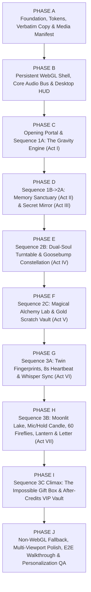

# 10 — SEQUENTIAL IMPLEMENTATION ROADMAP & MODEL HANDOFF

**Document ID:** `DOC-10`  
**Target Implementation Model:** Gemini 3.8 Flash High  
**Execution Rule:** Strict sequential phase gating. Complete, verify, and pass each phase's tests before beginning the next phase.

---

## 1. Dependency-Aware Phase Sequence Evaluation

We evaluated the baseline 10-phase sequence (`Phase A` through `Phase J`) and made **one deliberate architectural dependency improvement**:
- **Adjustment Explained:** In the raw list, the *Audio Engine* was grouped late with *Heartbeat* in `Phase G`. However, `OPENING` requires the user-gesture `AudioContext` unlock, `ACT I` triggers the opening voice recording + chime, and `ACT IV` requires dual-deck `Side A / Side B` music crossfading and vinyl pitch-scratching.
- **Superior Dependency Ordering Adopted Below:** We initialize the **Core Gesture-Gated Audio Engine & Procedural Synth Bus in `Phase B`** alongside the persistent WebGL shell and HUD (`SoundControlPill`), so every act from Opening through Act V integrates real sound hooks cleanly on first build. `Phase G` then focuses cleanly on **Act VI (8-Second Heartbeat Synchronization Ritual, 64→128 BPM Lub-Dub Scheduler & Whisper Sequencer)** plus **Microphone Breath Analyzer preparation** for Act VII.

---

## 2. Detailed Phase Specifications (`PHASE A` – `PHASE J`)

### PHASE A — Foundation, Design Tokens, Verbatim Content & Media Manifest
- **Prerequisites:** Approved `docs/planning/00..13` + `SOURCE_STORY_AND_COPY.md` in root.
- **Files / Components:** `package.json`, `tsconfig.json`, `vite.config.ts`, `playwright.config.ts`, `index.html`, `src/styles/tokens.css`, `src/styles/globals.css`, `src/types/*.ts`, `src/config/storyContent.ts`, `src/config/mediaManifest.ts`, `src/config/chapters.ts`, `src/store/useExperienceStore.ts`, `src/store/transientMotionState.ts`, `src/store/persistence.ts`, `tests/unit/storyContentIntegrity.test.ts`, `tests/unit/storePersistence.test.ts`.
- **Implementation Details:** Initialize Vite + React + TS + Tailwind + Vitest + Playwright. Encode all 9 principal colour tokens, fluid desktop typography (`Cormorant Garamond`, `Plus Jakarta Sans`, `Caveat`), native `<dialog>` scroll-containment CSS, verbatim `STORY_DATA` payload + typed empty slots (`memories`, `actualGift`, `liveCall`), central `mediaManifest.ts`, and versioned `uci_gravity_v1` Zustand store.
- **Expected Browser Result:** `#040407` dark shell renders cleanly at `1440×900` with token-styled typography smoke sheet and zero console errors.
- **Dependencies:** `react`, `react-dom`, `zustand`, `tailwindcss`, `vitest`, `@playwright/test`.
- **Tests:** `npm run test:unit` verifying 100% character-for-character match against `SOURCE_STORY_AND_COPY.md` and `localStorage` hydration/corruption resilience.
- **Acceptance Criteria:** `tsc --noEmit` passes `0` errors; `storyContentIntegrity.test.ts` passes 100% of verbatim string assertions.
- **Risks & Mitigations:** Accidental copy alteration → caught immediately by automated diff test against `SOURCE_STORY_AND_COPY.md`.
- **Gate Before Phase B:** Unit tests green; `public/media/` folder skeleton created with `README.md` drop-in guide.

---

### PHASE B — Persistent Three.js Engine, Core Audio Bus & Desktop Navigation HUD
- **Prerequisites:** Phase A complete.
- **Files / Components:** `src/engine/webgl/PersistentStage.tsx`, `CameraRig.tsx`, `LightingDirector.tsx`, `AssetDisposal.ts`, `materials/luxuryMaterials.ts`, `src/engine/motion/ScrollDirector.ts`, `gestureArbitrator.ts`, `src/engine/audio/AudioEngine.ts`, `ProceduralAudio.ts`, `haptics.ts`, `src/components/hud/*`, `src/components/media/SmartImage.tsx`, `HeirloomMediaPlaceholder.tsx`, `VoicePlayerPill.tsx`, `src/components/a11y/*`, `src/components/fallback/SceneErrorBoundary.tsx`.
- **Implementation Details:** Mount single persistent `<Canvas>` with adaptive DPR (`[1, 1.75]`), `visibilitychange` frame pause, singleton `luxuryMaterials`, `CameraRig` preset interpolator across all 10 stages, gesture-gated `AudioEngine` (independent Music/SFX gains + voice ducking + gentle procedural chimes), `ChapterRail`, `SoundControlPill` popover, `ComfortControls` (`Skip Scene`, `Reduced Motion`), and zero-broken-icon `SmartImage` / `VoicePlayerPill`.
- **Expected Browser Result:** Navigating across placeholder stage anchors smoothly interpolates camera & lighting presets inside one uninterrupted WebGL context; `SoundControlPill` mutes/unmutes cleanly; missing images render luxury `U ♥ S` filigree cards.
- **Dependencies:** `three`, `@types/three`, `@react-three/fiber`, `@react-three/drei`, `gsap`, `framer-motion` (`motion`).
- **Tests:** Playwright check confirming single `<canvas>` instance persists across chapter transitions, zero autoplay audio before click, and zero `404` broken image icons.
- **Acceptance Criteria:** Zero WebGL context recreation across act changes; `prefers-reduced-motion` toggle disables camera fly-rushes instantly.
- **Risks & Mitigations:** GSAP `ScrollTrigger` vs `<dialog>` scroll-lock conflict → prevented by native `dialog:modal { overscroll-behavior: contain }` without touching `body` overflow.
- **Gate Before Phase C:** Persistent canvas, HUD controls, and procedural audio fallback verified at `1440×900` and `1280×720`.

---

### PHASE C — Opening Portal & Sequence 1A: The Gravity Engine (Act I)
- **Prerequisites:** Phase B complete.
- **Files / Components:** `src/acts/OpeningPortal.tsx`, `src/acts/Act1TwoCountriesOneSky.tsx`, `src/engine/webgl/sequences/Sequence1GravityEngine.tsx`, `src/engine/webgl/objects/GravitySphereGroup.tsx`, `StarBridgeGroup.tsx`.
- **Implementation Details:** Build `SCR-00` starry void + radial rose-gold visual heartbeat + 3-line long-distance prelude → verbatim `heroOpening` lockup + `ENTER MY UNIVERSE` gesture gate (with `Resume` option if `visitedChapters.length > 1`). Build `OBJ-01-GRAVITY-ENGINE` (split N/S glass hemispheres, 7 independent gimbal rings, rose-gold heart, 12 instanced crystal shards, orbital dust), pointer-drag damped rotation, `220vh` pinned reversible scroll explosion (`0.0 ↔ 1.0`), and `YOU ↔ UCI` golden Bezier thread drag + keyboard `Connect Our Skies` + Opening Voice transcript/audio trigger.
- **Expected Browser Result:** Clicking `ENTER MY UNIVERSE` flies into the gleaming assembled Gravity Engine; dragging rotates it smoothly; scrolling down explodes the shells and 7 rings; scrolling back up reassembles it deterministically; connecting `YOU` to `UCI` ignites the golden bridge and reveals the opening voice greeting.
- **Dependencies:** Phase B engine.
- **Tests:** E2E test verifying muted entry, sphere drag rotation, forward scroll disassembly (`progress > 0.9`), reverse scroll reassembly (`progress < 0.05`), and `YOU ↔ UCI` bridge completion via both drag and keyboard.
- **Acceptance Criteria:** `AT-01` through `AT-06` pass across desktop viewports.
- **Risks & Mitigations:** Pointer drag on sphere blocking wheel scroll → `gestureArbitrator` only captures pointer on `pointerdown`, leaving wheel events free for `ScrollTrigger`.
- **Gate Before Phase D:** Seamless Opening → Act I → reverse-scroll reassembly verified at `60fps`.

---

### PHASE D — Sequence 1B → 2A: Memory Sanctuary (Act II) & Secret Mirror (Act III)
- **Prerequisites:** Phase C complete.
- **Files / Components:** `src/acts/Act2LittleThingsIKeep.tsx`, `src/acts/Act3SecretMirror.tsx`, `src/engine/webgl/objects/MemoryFramesCluster.tsx`, `MechanicalMirrorRig.tsx`, `src/engine/canvas2d/FogMirrorCanvas.tsx`, `tests/unit/revealThresholdMath.test.ts`.
- **Implementation Details:** Choreograph Act I's 12 crystal fragments settling into Act II's 6 distinct floating keepsake silhouettes (`photograph`, `shared-moment`, `inside-joke`, `music-memory`, `voice-note`, `personal-confession`) with native `<dialog>` inspector `SCR-02M` and heirloom empty-media states. Choreograph Act II exit where the 6 champagne bezels interlock into Act III's vanity mirror frame. Build high-DPI `FogMirrorCanvas` (`destination-out`, `~45 CSS px` scaled feathered brush + droplet trails), per-note bounding-box clearance detector (`≥ 55%` reveals each of the 5 exact `steamyMirrorNotes`), `Breathe on Glass` refog animation, and the liquid-ripple 4-ring horological portal dive into Sequence 2.
- **Expected Browser Result:** All 6 keepsake modals open/close via click & `Esc`; wiping the steamy mirror reveals all 5 glowing handwritten notes at exact `(x%, y%)` spots; `Breathe on Glass` restores condensation smoothly; completing `5/5` ripples the mirror and flies the camera through the separating mechanical bezel.
- **Dependencies:** Phases A–C.
- **Tests:** Unit test on DPR-independent alpha-grid clearance math; E2E pointer-wipe sweep across `(22%,25%)`, `(72%,28%)`, `(28%,68%)`, `(75%,72%)`, `(50%,48%)` asserting all 5 notes illuminate and `Breathe on Glass` resets cleared `%` to `0%`.
- **Acceptance Criteria:** `AT-07` through `AT-11` pass.
- **Risks & Mitigations:** `getImageData` pixel readbacks causing frame drops during wipe → maintain a lightweight `64 × 36` offscreen occupancy grid updated mathematically per brush stroke (`O(1)` per frame, zero GPU-CPU `getImageData` stalls!).
- **Gate Before Phase E:** Act I → II → III → Portal Dive continuous transition verified forward and backward.

---

### PHASE E — Sequence 2B: Dual-Soul Vinyl & Goosebump Constellation (Act IV)
- **Prerequisites:** Phase D complete.
- **Files / Components:** `src/acts/Act4TwoSidesOfUs.tsx`, `src/engine/webgl/sequences/Sequence2AnatomyOfUs.tsx`, `src/engine/webgl/objects/DualSoulTurntable.tsx`, `ConstellationAstrolabe.tsx`.
- **Implementation Details:** Build `OBJ-05-TURNTABLE` behind the mirror portal: brushed obsidian plinth, procedural micro-groove platter, orbiting circular `grooveText`, clickable tonearm needle drop, rotary pointer drag (`atan2` angular velocity controlling RPM & Web Audio `playbackRate`/scratch filter), `Send Kiss 💋` lipstick particle emitter, and full world/lighting/music/4-confession switch between `SIDE A // SUNLIGHT & SWEETHEART` and `SIDE B // 2:00 AM BEHIND CLOSED DOORS 🔥`. Implement 4A → 4B dissolve where the platter's 8 internal golden bearings rise into the pitch-black room as the 8 `constellationNodes`, illuminated by the silk cursor spotlight, drawing golden connecting tubes, triggering optional `"spicy"` haptics, opening the right-hand `<dialog popover="manual">` Discovery Drawer, bursting at `8/8`, and descending into Act V's spindle.
- **Expected Browser Result:** Tonearm starts/stops record; dragging vinyl audibly/visually scrubs speed; Side A ↔ Side B transforms the entire room, sound, groove text, and confessions; cursor spotlight uncovers all 8 stars into a connected golden constellation.
- **Dependencies:** Phases B–D.
- **Tests:** E2E test toggling tonearm, switching Side A ↔ Side B, verifying verbatim confessions, clicking all 8 stars, and asserting `8/8` supernova unlock.
- **Acceptance Criteria:** `AT-12` through `AT-16` pass.
- **Risks & Mitigations:** Discovery Drawer covering right-side stars (`76%`, `74%` X) on `1280×720` → Star stage dynamically shifts its container width to the left `68%` (`padding-right: 360px`) whenever the Discovery Drawer opens so star `(76%, 48%)` and `(74%, 80%)` are never occluded!
- **Gate Before Phase F:** Full Sequence 2A → 2B choreography verified across `1440×900` and `1280×720`.

---

### PHASE F — Sequence 2C: The Uci Formula & Gold Scratch Vault (Act V)
- **Prerequisites:** Phase E complete.
- **Files / Components:** `src/acts/Act5UciFormula.tsx`, `src/engine/webgl/objects/AlchemyVesselRig.tsx`, `src/engine/canvas2d/FoilScratchCanvas.tsx`.
- **Implementation Details:** Transform central spindle into `OBJ-07-ALCHEMY` borosilicate flask at `37°C` surrounded by the 4 exact ingredient vials (`40%`, `30%`, `20%`, `10%`). Implement vial tip-and-pour animations, rising fluid meniscus shader, colour-shifting lab lighting, and 4th-vial comedic boil → ballistic cork launch → `999°C` gauge slam → `DANGER: TOO HOT TO HANDLE. BOYFRIEND WILLPOWER COMPROMISED.` banner. Glide in the 2×2 `FoilScratchCanvas` Gold Scratch Vault (`32 × 20` cell tracker, `≥ 45%` threshold auto-dissolving remaining foil), verbatim `scratch-1..4` secrets, `Keep Promise ♥` toggle, `Re-foil Card` replay, and exit fold into 4 obsidian chassis panels.
- **Expected Browser Result:** Pouring all 4 vials detonates the comedic `999°C` cork launch and reveals 4 shimmering gold scratch cards that scratch smoothly with mouse/touch and dissolve cleanly past `45%`.
- **Dependencies:** Phases D–E.
- **Tests:** Unit test verifying `45%` scratch threshold math; E2E test clicking all 4 vials, asserting `999°C` + exact warning text, and scratching all 4 cards past `45%`.
- **Acceptance Criteria:** `AT-17` through `AT-19` pass.
- **Risks & Mitigations:** Four 2D canvases on `1280×720` clipping vertically → responsive compact card grid (`max-height: 210px` per card at `720p`) verified in storyboard budget.
- **Gate Before Phase G:** Sequence 2 complete from Mirror Portal through Scratch Vault fold.

---

### PHASE G — Sequence 3A: Even Across the Distance & Heartbeat Sync (Act VI)
- **Prerequisites:** Phase F complete.
- **Files / Components:** `src/acts/Act6AcrossTheDistance.tsx`, `src/engine/webgl/sequences/Sequence3ImpossibleGift.tsx` (Stage 3A), `src/engine/webgl/objects/TwinFingerprintField.tsx`, `src/engine/audio/MicrophoneAnalyzer.ts` (pre-built & unit-tested for Phase H).
- **Implementation Details:** Build quiet `#040407` chamber with twin parametric ridge-line 3D fingerprints (`OBJ-08-FINGERPRINTS`). Implement the `0.0s → 8.0s` continuous hold ritual supporting Mouse Hold, Touch Hold (suppressing context menu), and Keyboard `Space`/`Enter` Hold (ignoring `event.repeat`), golden silk spline bridge formation, `64 → 128 BPM` eased visual + discrete acoustic lub-dub pulse scheduler, sequential fade-in of all 6 verbatim `heartbeatWhispers`, gentle non-punitive early-release message, 8.0s fusion into the radiant Golden-Rose Heart, and `Replay Ritual` control.
- **Expected Browser Result:** Holding for 8 seconds draws the two fingerprints together across a golden silk bridge as the heartbeat accelerates to `128 BPM` through all 6 whispers before merging into one glowing heart; releasing at `3s` shows a tender reassurance prompt.
- **Dependencies:** Phases B & F.
- **Tests:** E2E test simulating both early release (`2.5s`) and full `8.1s` hold (pointer & keyboard `Space`), asserting all 6 whispers and heart fusion.
- **Acceptance Criteria:** `AT-20` and `AT-21` pass; zero biometric claims anywhere in UI.
- **Risks & Mitigations:** OS keyboard auto-repeat restarting hold timer → explicitly guard `if (e.repeat) return;` on `keydown`.
- **Gate Before Phase H:** Act VI hold ritual & heart-rise horizon transition into Act VII verified.

---

### PHASE H — Sequence 3B: Moonlit Lake, Candle, 60 Fireflies, Lantern & Love Letter (Act VII)
- **Prerequisites:** Phase G complete.
- **Files / Components:** `src/acts/Act7MoonlitWish.tsx`, `src/engine/webgl/objects/MoonlitLakeDiorama.tsx`.
- **Implementation Details:** Build `OBJ-09-MOONLIT-LAKE` diorama: reflective indigo lake, artisan cake, reactive `CandleFlameShaderMesh`, verbatim `"Make a wish, cintaku. This one's just for you."`, co-equal `Hold to Blow Out Candle` (`1.6s`) + optional `Use Microphone to Blow 🎙️` (`MicrophoneAnalyzer` with instant `track.stop()` on extinguish/unmount and calm denial fallback). Upon extinguish, spawn exact **60 instanced golden fireflies** rising into the translucent 3D Sky Lantern, trigger Birthday Music-Box melody, present Wish input + optional verbatim `"Include one unspoken naughty wish for us tonight."` + `"RELEASE INTO THE NIGHT SKY"` launching hero lantern + 10 distant horizon lanterns. Present `U ♥ S` crimson wax-sealed 3D/DOM luxury envelope, fracture particle burst on tap/hold, unfold `#F5EBDD` parchment sheet with 100% verbatim `birthdayLetter` + optional non-autoplaying `VoicePlayerPill`.
- **Expected Browser Result:** Candle extinguishes effortlessly without mic permission (and reacts live to breath if mic opted-in); 60 fireflies illuminate the sky lantern; releasing the wish floats lanterns across the moonlit sky; cracking the `U ♥ S` crimson wax seal unfolds the complete birthday letter.
- **Dependencies:** Phases B & G.
- **Tests:** E2E tests covering mic-denied candle blow-out, wish entry + naughty checkbox + lantern release, and `U ♥ S` wax seal crack asserting every paragraph and signature of `birthdayLetter`.
- **Acceptance Criteria:** `AT-22` through `AT-25` pass.
- **Risks & Mitigations:** Lingering active microphone indicator after Stage 7A → verified via automated test checking `MediaStreamTrack.readyState === 'ended'` immediately after candle extinguish.
- **Gate Before Phase I:** Complete Act VII emotional arc verified end-to-end.

---

### PHASE I — Sequence 3C Climax: The Impossible Gift & After-Credits VIP Vault
- **Prerequisites:** Phase H complete.
- **Files / Components:** `src/acts/FinalGiftReveal.tsx`, `src/acts/AfterCreditsVipVault.tsx`, `src/engine/webgl/objects/LuxuryGiftBoxRig.tsx`.
- **Implementation Details:** Choreograph `OBJ-10-IMPOSSIBLE-GIFT` grand assembly (`160vh` reversible convergence bringing together the 4 obsidian panels, Act I's 7 orbital filigree rings, Act IV's vinyl gold base medallion, 8 constellation star inlays, Act V's interior golden alchemy light, Act VI's merged heart gem & twin fingerprint clasp, and crimson silk ribbon bow). Support `360°` inspection drag, interactive crimson bow untie, `-112°` damped lid opening with volumetric golden light spill, and the configurable **Actual Gift Showcase** (`storyContent.actualGift` with royal heirloom placeholder until populated). Build `SCR-09` After-Credits two-tier 3D-flip VIP Vault (3 `SWEET // PRINCESS TIER` + 3 `AFTER-MIDNIGHT // 18+ SPICY 🔥` cards with exact `vipCoupons` titles/descriptions/codes, persisted claim timestamps, screenshot-ready front/back faces, `content-visibility: auto` optimization), verbatim closing vow, and configurable `CALL YOUR BOYFRIEND ❤️` button with warm glass fallback modal when `liveCall.url === ''`.
- **Expected Browser Result:** Every motif from Acts I–VII visibly assembles into the black-glass and champagne-gold gift box; untying the crimson ribbon opens the box in a dramatic climax; below/after, all 6 VIP passes flip in 3D, persist redemptions across page reloads, and culminate in the Call CTA.
- **Dependencies:** Phases A–H.
- **Tests:** E2E tests verifying gift convergence, `360°` drag, ribbon untie & gift reveal, all 6 VIP card flips + persisted claim timestamps across `page.reload()`, and graceful empty-URL call modal.
- **Acceptance Criteria:** `AT-26` through `AT-29` pass.
- **Risks & Mitigations:** Gift reveal feeling secondary to VIP coupons → `SCR-08` owns a dedicated full-screen 3D theatre climax before Uci explicitly advances/scrolls into `SCR-09` After-Credits.
- **Gate Before Phase J:** Complete Opening → After-Credits journey playable end-to-end.

---

### PHASE J — Non-WebGL Fallback, Edge Privacy Gate, Multi-Viewport QA, Playwright Walkthrough & Personalization Readiness
- **Prerequisites:** Phase I complete.
- **Files / Components:** `src/components/fallback/WebGLFallbackStage.tsx`, `functions/_middleware.ts`, `public/_headers`, `public/robots.txt`, `tests/unit/edgeAuthMiddleware.test.ts`, `tests/e2e/fullJourneyWalkthrough.spec.ts`, `reverseScrollAndNavigation.spec.ts`, `permissionsAndMissingMedia.spec.ts`, `accessibilityAndKeyboard.spec.ts`, `viewportsDesktopMatrix.spec.ts`.
- **Implementation Details:** Complete `WebGLFallbackStage` 2.5D visual compositions for WebGL-disabled environments; implement `functions/_middleware.ts` HMAC-signed `HttpOnly` cookie gate protecting both webpage navigation (`/*`) and direct personal media requests (`/media/*`) per `OQ-05` + privacy headers (`noindex`, `no-referrer`, `Cache-Control: private, no-store` on `/media/*`, CSP); execute full Playwright matrix across all 5 desktop viewports (`1920×1080`, `1680×1050`, `1440×900`, `1366×768`, `1280×720`) capturing milestone screenshots at every stage; profile bundle sizes, FPS, draw calls, memory disposal, keyboard-only walkthrough, reduced-motion walkthrough, and hot-swap media drop-in test.
- **Expected Browser Result:** Unauthenticated direct requests to `/media/*` return `401 Unauthorized`; authenticated sessions experience zero console errors, zero uncaught page errors, zero overlapping hitboxes, crisp framing across all 5 desktop resolutions, and verified milestone screenshots from Opening to After-Credits.
- **Tests:** Full Vitest + Playwright suite (`npm run test:unit && npm run test:e2e`).
- **Acceptance Criteria:** All `35` acceptance tests (`AT-01` through `AT-35` in `DOC-11`) pass with captured visual evidence.
- **Gate for Launch / Owner Personalization:** Present verified build, private sharing workflow, & exact drop-in asset checklist (`DOC-06`) to owner.

---

## 3. Handoff Directives for `Gemini 3.8 Flash High`

1. **Read Order Before Coding:** Read `00` → `06` → `08` → `05` → `04` → `03` → `07` → `09` → `11` before creating `package.json`.
2. **Never Paraphrase `STORY_DATA`:** Copy `STORY_DATA` from `SOURCE_STORY_AND_COPY.md` into `src/config/storyContent.ts` verbatim and run `storyContentIntegrity.test.ts` in Phase A before building any UI.
3. **Respect Animation Ownership (`DOC-04 §1`):** Never put Three.js Euler angles in React `useState`; always route scroll scalars and pointer deltas through `transientMotionState.ts`.
4. **Verify Visually in Real Headless/Headed Chromium:** Never mark a phase complete based solely on `tsc` or `vite build`. Run the phase's Playwright interaction spec, inspect screenshots at `1440×900` and `1280×720`, and assert zero `console.error` / `pageerror` events.
